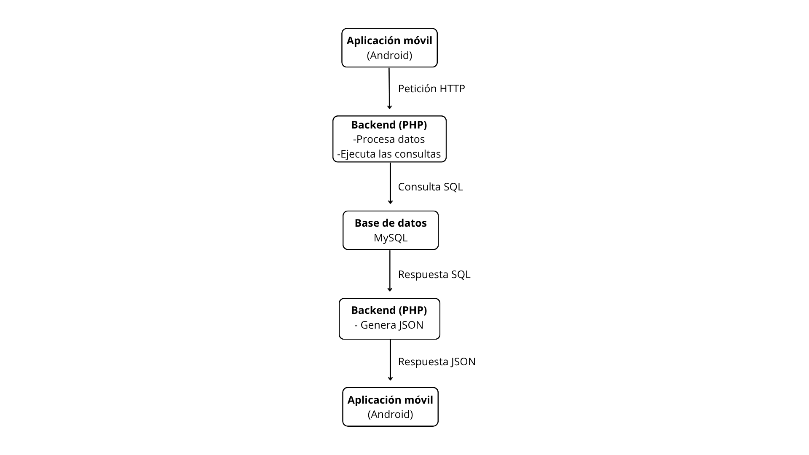

# FitBooking

**Aplicación Android para la gestión y reserva de clases.**

##Índice
- [Título e imagen de portada](#Título-e-imagen-de-portada)
- [Insignias](#insignias)
- [Índice](#índice)
- [Descripción del proyecto](#descripción-del-proyecto)
- [Objetivo del proyecto](#objetivo-del-proyecto)
- [Funcionalidades](#funcionalidades)
- [Tecnologías utilizadas](#tecnologías-utilizadas)
- [Arquitectura](#arquitectura)
- [Estructura del proyecto](#estructura-del-proyecto)
- [Requisitos](#requisitos)
- [Autora](#autora)

## Título e imagen de portada

FitBooking es una aplicacion Android orientada a facilitar la gestión de clases de un centro deportivo.


## Descripción del proyecto

FitBooking es una aplicación desarrolada como Proyecto final del Grado Superior en Desarrollo de Aplicaciones Multiplataforma (DAM).

Esta aplicación permite organizar clases y gestionar las reservas desde el móvil. Está diseñada con una interfaz sencilla e intuitiva, la cual facilita su uso tanto a los usuarios como al administrador del centro.

El proyeecto surge de la necesidad de mejorar la organización de las clases y reservas, evitando depender de mensajes individuales para comunicar cambios o ausencias.

## Objetivo del proyecto

Desarrollar una aplicación quesimplifique la gestión de clases y sus reservas, centralizando la información y facilitando la organización del centro deportivo.

## Funcionalidades

### Usuarios

- Inicio de sesión
- Consulta del calendario de clases
- Consulta de las clases disponibles
- Gestión de reservas y cancelaciones
- Consulta de la información relacionada con las clases

### Administración

- Gestión de usuarios
- Creación y gestión de clases
- Consulta de las reservas de cada clase
- Consulta de los usuarios inscritos
- Gestión de la información relacionada con las clases y sus participantes

## Tecnologías utilizadas

- **Java**: desarrollo de la aplicación Android
- **Android Studio**: entorno de desarrollo
- **XML**: diseño de las interfaces
- **PHP**: desarrollo de los scripts del servidor
- **MySQL**: gestión de la base de datos
- **Gradle**: configuración y compilación del proyecto
- **Git y GitHub**: control de versiones y alojamiento del código

## Arquitectura

FitBooking utiliza una arquitectura cliente-servidor. La aplicación Android realiza peticiones HTTP a una API desarrollada en PHP, que procesa las solicitudes y se comunica con la base de datos MySQL.




## Estructura del proyecto

```text
FitBooking/
├── app/
│   └── src/
│       ├── main/
│       │   ├── java/
│       │   ├── res/
│       │   └── AndroidManifest.xml
│       ├── androidTest/
│       └── test/
├── backend/
│   └── Scripts PHP de la API
├── gradle/
├── .gitignore
├── build.gradle.kts
├── gradle.properties
├── settings.gradle.kts
└── README.md
```

## Requisitos

Para ejecutar el proyecto se necesita:

- Android Studio
- Un JDK compatible con la configuración de Gradle
- Un dispositivo Android o un emulador
- Un servicio web compatible con PHP
- Una base de datos MySQL

## Autora
**Irene Reguero Castro**
Proyecto realizado como trabajo final del Grado Superior en Desarrollo de Aplicaciones Multiplataforma (DAM).
